<div align="center">



</div>



## `$ ls ./projects`

```
 #   PROJECT                                      DOMAIN
 ─────────────────────────────────────────────────────────────────────
 01  Custom Second-Order Optimizer                Optimization
 02  Continual Few-Shot Learning                  Continual Learning
 03  Spectral Filter Utility Modulation           Continual Learning
 04  Memory-Efficient Full-Parameter Optimizer    Optimization / LLMs
 05  Bilinear Fallacy Detection & Steering        Interpretability / NLP
```


## 01 · Custom Second-Order Optimizer

> A novel optimizer comparable to Adam, built on pseudo second-order information.

```
  gradients ──► pseudo 2nd-order curvature estimate ──► adaptive update
```

- Incorporates pseudo second-order gradient information to capture the curvature of the loss landscape
- Significantly improves convergence rates in deep architectures

`Optimizer Design` `Deep Learning` `PyTorch`


## 02 · Continual Few-Shot Learning

> A CV framework for lifelong adaptation from minimal examples.

```
  new class ──► few examples ──► adapt ──► old knowledge retained
                                  (no catastrophic forgetting)
```

- Generates novel classes and adapts continually over time
- Learns and generalizes from minimal training examples (few-shot)
- Avoids catastrophic forgetting

`Few-Shot Learning` `Continual Learning` `Computer Vision`


## 03 · Spectral Filter Utility Modulation for Continual Learning

> One-shot continual learning that protects the filters a network still needs.

```
  task t ──► Spectral Filter Flux Tracking ──► utility scoring
                                                    │
        scaled LR per filter group ◄── overlay modulator
```

- One-shot continual learning framework across **20 CIFAR-100 tasks** (task-incremental)
- **Spectral Filter Flux Tracking** and activation-gradient utility scoring to detect and quantify disruption of critical filters
- Overlay modulator dynamically scales learning rates for specific filter groups, restricting updates to previously useful filters

`Continual Learning` `CIFAR-100` `Catastrophic Forgetting`


## 04 · Memory-Efficient Full-Parameter Optimization

> Full-parameter fine-tuning of large models on standard 8GB consumer GPUs.

```
  training data ──► Randomized QR ──► orthonormal basis
                                           │
  momentum buffers ──► transition matrix ──┴──► pivoted, trajectory preserved
                       (basis shifts in float32)
```

- Memory-efficient optimizer enabling full-parameter fine-tuning on **8GB GPUs**
- **Randomized QR Decomposition** compresses training data into a low-overhead orthonormal basis
- A transition matrix pivots historical momentum buffers without losing the training trajectory
- Basis shifts computed in temporary **float32** to prevent underflow
- Faster processing than competing memory-saving tools

`Randomized QR` `Optimizer` `Large Model Fine-Tuning`


## 05 · Bilinear Fallacy Detection & Steering (BFDS)

> Inference-time detection and correction of logical fallacies in small AI models, with no retraining.

```
  premises ──► layer probes ──► vectors (u, v) ──► bilinear score (u × v)
                                                         │
                          steer model  ◄── threshold ◄───┘
                          (1–10% frequency cap)
```

- Internal layer probes map interacting premises into vectors **u** and **v**
- Bilinear activation score (u × v) identifies logical errors in the data stream
- Activation threshold tuned against normal text, limiting steering to a **1–10%** frequency to prevent overcorrection

`Interpretability` `Activation Steering` `NLP`

<br>

<div align="center">



</div>
